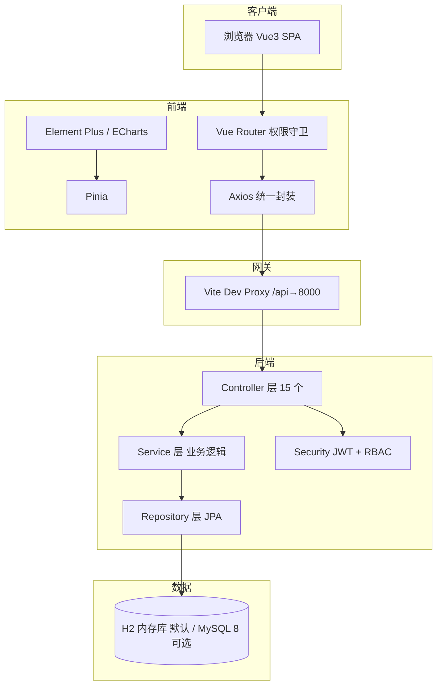

# 企业员工管理系统（HRMS）

> 数据驱动决策 · 人才价值可量化 · 全员自助协作

面向中小型企业的**一体化人力资源数字化平台**，覆盖员工全生命周期「选、用、育、留」的 8 大业务模块，内置 **HR 智能助手**（自然语言问数）与多层数据可视化（HR 运营看板 / 部门管理看板 / 专项分析），企业级 B2B 视觉设计（商务蓝 `#2f6bf0` + 明暗双主题），前后端分离全栈可运行。

本仓库为**从零完整实现**的可运行系统：后端 Spring Boot 3（默认 H2 内嵌库，可选 MySQL），前端 Vue 3 + Element Plus + ECharts，内置 61 名员工（在职 57 人，符合中型团队规模）/ 22 部门 / 46 岗位 / 7 个月考勤与薪酬的演示数据，`./start.sh` 一键启动即可体验全部功能，并支持 CloudStudio 云 IDE 一键运行。

---

## 一、项目简介

- **形态**：前后端分离的 Web 应用（SPA + REST API）
- **角色**：系统管理员（ADMIN）/ HR 专员（HR）/ 部门主管（MANAGER）/ 普通员工（EMPLOYEE）四类，RBAC 权限贯穿前后端
- **规模**：后端 22 个领域实体、15 个 REST 控制器、7 个业务服务、20+ Repository；前端 12 个业务页面、5 个通用组件、10+ 可视化图表
- **演示数据**：`Random(42)` 固定随机种子，`create-drop` 每次启动重建库表，结果可复现、可反复演示

## 二、技术栈

| 层次 | 技术 | 版本 | 用途 |
|---|---|---|---|
| 后端语言 | Java | 17 | — |
| 后端框架 | Spring Boot | 3.3.5 | Web / JPA / Security / Validation |
| ORM | Spring Data JPA | — | 实体驱动建表（`ddl-auto: create-drop`）+ Repository 查询 |
| 安全 | Spring Security + JWT（jjwt） | 0.12.6 | 无状态认证 + 方法级授权 `@PreAuthorize` |
| 数据库 | H2（默认）/ MySQL 8.x（可选） | — | 默认 `jdbc:h2:mem:hrms` 内嵌内存库（MODE=MySQL，免安装零配置）；本地 MySQL 用 `mysql` profile，账号密码由环境变量 `DB_USERNAME` / `DB_PASSWORD` 注入 |
| 前端框架 | Vue 3（组合式 API + `<script setup>`） | ^3.4 | — |
| 构建工具 | Vite | ^5.3 | 秒级 HMR、echarts/element-plus 手动分包 |
| 类型 | TypeScript | ^5.4 | 全链路类型安全（vue-tsc 校验） |
| UI 组件 | Element Plus | ^2.7 | 中后台组件库（按需引入图标） |
| 可视化 | Apache ECharts | ^5.5 | 折线/柱状/饼图/热力图/漏斗/雷达 |
| 状态管理 | Pinia | ^2.1 | 认证、主题、侧边栏状态 |
| 路由 | Vue Router 4 | ^4.4 | 动态权限路由 + 导航守卫 |
| HTTP | Axios | ^1.7 | 拦截器统一处理 token / 错误码 / 401 |

## 三、系统架构



**认证授权链路**：登录签发 JWT（subject=用户名，含 `uid / role / employeeId` 声明）→ 前端存入 localStorage → 每次请求 Axios 拦截器附加 `Authorization: Bearer` → `JwtAuthenticationFilter` 解析校验并写入 SecurityContext → 后端 `@PreAuthorize("hasAnyRole('ADMIN','HR')")` 方法级鉴权 → 前端路由 `meta.roles` 过滤菜单 + 导航守卫双重兜底。

**数据关联策略**：为避免 JPA 懒加载序列化问题，实体间采用**扁平外键（Long 字段）+ 少量 EAGER `@ManyToOne`**，跨实体聚合统一在 Service 层组装，保证接口出参稳定。

## 四、功能模块（8 大模块）

| 模块 | 核心能力 |
|---|---|
| 🏢 组织人事 | 组织架构树、P/M 双序列岗位体系、员工全生命周期档案（合同 / 教育 / 异动 Tab）、人才标签 |
| 📅 考勤排班 | 班次配置、出勤月历热力、异常自动识别（迟到/早退/缺勤）、月度汇总、一键确认归档 |
| 💰 薪酬福利 | 一键批量核算（幂等重建）、应发/扣减/实发明细、五险一金与个税、成本构成饼图、部门成本、工资条、状态流转 `DRAFT→CALCULATED→CONFIRMED→PAID` |
| 🎯 绩效目标 | OKR/KPI/360 多模式、评级分布（A/B/C/S）、得分区间、绩效面谈记录 |
| 🎓 培训发展 | 课程库（12 门）、学习记录、能力雷达图 |
| 🧲 招聘人才 | 岗位需求（8 个）、候选人漏斗（简历→Offer→入职）、渠道效能（拉勾/猎聘/官网/BOSS…） |
| 🧑‍💼 全员自助 | 个人档案卡（入职/九宫格定位/标签）、假期余额、我的考勤、我的工资条、我的绩效、电子证明申请闭环（PENDING） |
| 🤖 智能助手 | 自然语言问数（规则式 NLP 意图引擎，零外部 LLM）：问「各部门多少人」「平均薪资」「招聘漏斗」「人才九宫格」，回复=自然语言结论 + 实时图表 + 推荐追问；支持「我的考勤 / 我的绩效 / 我的工资」个人自助问答与多轮追问续接，按角色收敛薪资成本敏感数据 |
| 🔐 系统管理 | RBAC 用户、数据字典、操作审计日志 |

## 五、核心实现思路（怎么实现的）

### 1. 数据层：演示数据即业务骨架
- `ddl-auto: create-drop` + `DataSeeder`（`Random(42)` 固定种子）——每次启动重建库表并重灌数据，**演示环境天然可复现、可重置**。
- 规模设计：22 部门（集团→中心→部门 3 级树）、46 岗位、61 员工（在职 57 人）、7584 条考勤、399 条薪酬、3 期绩效、12 课程、90 候选人。
- 关联靠扁平外键，跨实体统计在 Service 手写聚合，避免 N+1 与序列化陷阱。

### 2. 安全层：一条 JWT 贯穿前后端
- 登录成功签发 JWT，声明中**嵌入 `employeeId`**，使员工自助接口能从 token 直接定位本人数据，无需前端传参。
- 四类角色的菜单、接口、数据三个维度分别收敛：路由 `meta.roles`、`@PreAuthorize`、以及 service 层按 `SecurityUtil` 当前用户过滤。

### 3. 智能助手：从被动看板到主动问数
- 将原「数据驾驶舱」的 10 类图表能力**封装为后端可复用的数据方法**（`AnalyticsService` / `DashboardService`），前端不再逐屏陈列图表，而是由用户**用中文提问、助手按需取数**——一次交互返回「自然语言结论 + 图表 + 表格 + 推荐追问」四件套。
- 意图引擎为**规则式 NLP**（关键词 + 同义词 + 部门名校对），无外部 LLM 依赖、无 API key、结果确定可测；覆盖 18 类意图（规模/部门/薪酬/考勤/招聘/结构/九宫格/人效/培训/绩效/能力雷达/个人自助…）。
- 轻量多轮上下文：内存记录「最近意图 + 最近问题」，用户追问「那最多的呢」自动续接上一话题；`EMPLOYEE` 角色问薪资/成本时按 `SecurityUtil.currentUser().role()` **降级为友好提示**，敏感数据不越权。
- 聊天历史按用户维度保存在后端内存并支持恢复，前端刷新页面后图表仍可还原。

### 4. 驾驶舱数据方法复用（原驾驶舱能力，现为助手数据源）
- `AnalyticsService` 一次性聚合出 KPI + 10 类图表数据；九宫格用 `potential × performance` 双维度索引映射到 3×3 热力图；漏斗按候选人状态机 `简历筛选→初试→复试→HR面→Offer→入职` 逐层递减统计。

### 5. 薪酬核算：幂等一键重算
- `calculate` 接口先删除该月旧记录再重建，演示期可反复重算而不产生脏数据；状态机推进 + 每步顶部 KPI 联动。

### 6. 主题与工程化
- CSS 变量双套令牌（`:root` / `html.dark`），一键切换明暗；`manualChunks` 将 echarts/element-plus 独立分包，首屏按路由懒加载。

## 六、遇到的问题与解决方案

> 以下均为开发过程中**实际遇到并解决**的问题，记录思路以便复用。

| # | 问题 | 根因 | 解决方案 |
|---|---|---|---|
| 1 | 后端接口大面积 500，但 `mvn compile` 不报错 | Maven **增量编译**静默跳过，旧 `target/classes` 未重新编译，打出的 jar 内含 ECJ `Unresolved compilation problem` 桩 | 强制全量编译暴露真实错误：`rm -rf target/classes && mvn compile`；并定位到 3 个类型不匹配的源码错误修复 |
| 2 | 员工自助全部 500 | `LoginUser` 记录缺 `employeeId`，JWT 未携带该声明 | 扩展 `LoginUser` 记录 + `JwtUtil` 条件写入 `employeeId` claim + `JwtAuthenticationFilter` 解析回填，一处改动三处闭环 |
| 3 | 驾驶舱九宫格 500 | `gridCell "9A"` 字符串解析：潜力为 1-9 数字、绩效为 A/B/C/S 字母，原代码把整串当数值 | 按字符位分别解析：`Character.digit` + 评级字母→索引映射，再落位 3×3 坐标 |
| 4 | 招聘漏斗 500 | 漏斗末端取值强转类型错误（`Object.doubleValue`） | 显式 `((Number) …).doubleValue()` 收敛数值 |
| 5 | 部门树根节点人数不对（≠全树求和） | 聚合按深度**升序**合并，子部门先归并导致父级统计滞后 | 改为按深度**降序**自叶向上合并：`Comparator.comparingInt(depth).reversed()`，根节点=全树在职员工之和 |
| 6 | 考勤班次表列错位/空 | 前端读取实体中不存在的幻影字段 `startTime/endTime/…` | 对照 `Shift` 实体改用 `workStart / workEnd / standardHours` 真实字段 |
| 7 | 访问不存在的接口返回 500 | 未处理 Spring 静态资源 404 异常 | 新增 `@ExceptionHandler(NoResourceFoundException)` → 统一返回 404 JSON |
| 8 | 薪酬接口越权：manager 也能算薪 | 缺类级方法授权 | 控制器类级 `@PreAuthorize("hasAnyRole('ADMIN','HR')")`；员工档案同理对 `EMPLOYEE` 拦截，回归验证 manager/employee 均 403 |
| 9 | 驾驶舱一进去就卡死 | ECharts 雷达图在**数据未返回**时用空 `indicators` 渲染，`radarLayout` 内部 `undefined.push` 抛异常，异常在 mounted 钩子里反复抛出导致主线程卡死 | 雷达数据为空时渲染空雷达占位，数据到达后再填充真实指标；用无头浏览器 CDP 复现 + 主线程心跳确认修复 |
| 10 | 招聘看板中文状态流转失败 | URL query 中文参数被 Git Bash **GBK 编码**篡改（假阴性） | 前端 `encodeURIComponent(status)` + 接口回归用 ASCII/URL-encoded 参数复核，确认是 shell 编码而非后端 bug |
| 11 | 旧系统残留占端口 | 新旧前端实例分占 5173/5174，浏览器打开的是旧实例 | 清理所有实例后统一到 5173，并验证 5173 返回的是新版本（标题/入口 HTML） |
| 12 | 端到端回归耗时不可控 | 手动 curl 逐接口验证繁琐 | 编写 **Workflow 多代理并行验证**：9 个代理按模块并行核验 60+ 接口（结构 + 数据正确性 + 权限），两轮 65→67 项全部通过 |
| 13 | 组织架构部门层级错乱（产品部挂到数据智能部下、销售部挂到客服部下） | 种子数据用「行号」作为 `parentId` 引用，但 4 个中心的父行号写错（写 7/10/14/17，应为 8/11/15/18） | 对照部门定义数组逐行修正：产品/设计部归产品中心、运营/市场/客服部归运营中心、销售部归销售中心、职能部归职能中心；同步修正岗位 `deptId`（产品/运营/销售/职能总监）同类错误 |
| 14 | 招聘漏斗渠道按钮（官网/BOSS直聘）点击后看不到人 | 前端把渠道值当 `status` 参数传给 `/candidates`，后端只认 status 故返回空 | 后端 `candidates` 新增 `channel` 参数 + `findByChannelOrderByApplyDateDesc`；前端 `candidates(params?)` 传 `{ channel }`；渠道按钮列表改用全量候选计算，避免筛选后按钮消失 |
| 15 | 驾驶舱部门下拉「点了没反应」 | 能力雷达出勤维度写死 `90 + random(7)` 恒为 95.0，各部门雷达几乎完全重合 | 出勤率改为近 3 个月**真实考勤**分部门计算（非迟到/缺勤占比）；薪资竞争力改为相对**公司均薪**；显式处理「全公司」 |
| 16 | 数据驾驶舱→智能助手：图表类型不统一 | 各意图返回的图表结构（柱/线/饼/漏斗/雷达）字段各异 | 后端统一为 `AssistantReply.chart` 五种类型契约（`categories/series/items/indicators/values`），前端 `toEchartsOption` 单一转换函数兜底 |
| 17 | 智能助手薪资数据越权 | `EMPLOYEE` 问「平均薪资」直接返回公司均薪，泄露敏感数据 | 服务层按 `SecurityUtil.currentUser().role()` 收敛：非 HR/管理者返回降级提示并推荐「我的工资」等自助问题 |
| 18 | 多轮追问「那最多的呢」无法理解 | 追问句不含任何关键词，意图引擎兜底 | 内存记录「最近意图 + 最近问题」，兜底时按上一意图 `replay` 重跑并提示"接着刚才的话题"；刷新页面由后端历史接口还原对话 |
| 19 | 未登录访问接口返回空响应 / 302，前端无法统一提示 | Spring Security 默认入口点对未认证请求无 JSON 输出 | `SecurityConfig` 自定义 `AuthenticationEntryPoint` 输出统一 JSON `{"code":401,"message":"未登录或登录已过期","data":null}`，前端 HTTP 401 分级提示 |
| 20 | 员工详情接口结构多层嵌套，各页面重复解析、易取错字段 | `detail()` 返回嵌套过深的 Map | 扁平化为 `{ employee:{id, employeeNo, name,…, managerName}, contracts, education, transfers, managerName }`，前端统一读 `res.employee` |
| 21 | 重复工号可创建/更新；删除员工残留孤儿数据 | `create/update` 未校验工号唯一；`delete` 未级联清理 | Service 层校验重复 `employeeNo` 抛 `BizException`；删除时级联清理合同/教育/异动并清空他人 `managerId / leaderId` 引用 |
| 22 | 组织树部分经理 `managerId` 为 null | DataSeeder 先 `saveAll` 再 `assignManagers`，但部分上级尚未持久化即被引用 | 拆为两段提交：`saveAll(all)` → `assignManagers(all, deptMap)` → `saveAll(all)`，保证上级已落库 |
| 23 | 已确认/已发放月份仍可一键重算；状态流转后可回退 | `calculate` 缺状态机前置校验；状态变更无独立接口 | 阻断 `PAID/CONFIRMED` 月份重算；新增 `PUT /payroll/records/{id}/status`，必须先 `CONFIRMED` 才能 `PAID`，状态持久化刷新后仍生效 |
| 24 | 考勤月历个别格子出勤率 NaN；月度汇总排序乱 | 出勤人数 `total=0` 时除零得 NaN；汇总未按异常优先排序 | 日历 rate 除零兜底 `: 0`；月度汇总按「有异常」优先排序，进度条三色档 |
| 25 | 培训记录状态比较失效（列表空白 / 状态错乱） | 前端把中文状态与英文 `COMPLETED/IN_PROGRESS` 混比 | 前端统一改用中文 `已完成/进行中/未开始`；`recordStatus` 增加中文映射（进行中→学习中） |
| 26 | 助手回复存在 XSS 注入风险（`` 等） | `v-html` 直接渲染后端拼接文本 | `renderText()` 先对 `& < > " '` 做 HTML 实体转义，再转 `**加粗**` 与换行，用户输入不可执行 |
| 27 | 未登录直达内页空白；登录失败被 401 拦截器整页跳转 | 原路由守卫无角色校验；拦截器对登录失败也触发 401 跳转 | 新增 async 守卫：无 token→`/login`、已登录访问登录页→`/`、`fetchMe` 失败→登出、角色不匹配→拦截回 `/dashboard`；拦截器对 `/auth/login` 跳过 401 跳转 |
| 28 | 全局搜索→员工详情抽屉打不开 | 员工列表按 id **降序**，低 id 员工不在第一页，前端 `rows.find` 找不到即不发详情请求 | 新增 `openDetailById(id)` 直接按 id 调详情接口，与当前列表分页无关，再打开抽屉 |
| 29 | 全局搜索「员工」Tab 对 EMPLOYEE 越权可见；员工页写操作对 MANAGER 可见 | 前端未按角色收敛 | 全局搜索 `canSearchEmployee` 仅 ADMIN/HR/MANAGER，EMPLOYEE 只见「功能」Tab；员工页新增/编辑/删除按 ADMIN/HR 收敛，MANAGER 只读 |
| 30 | 假期余额把「待审批」年假也算进剩余 | 自助假期查询未过滤状态 | 只统计 `APPROVED` 且类型为「年假」的假期；工资条改用 `findByEmployeeIdOrderByPayMonthDesc` 单查询拉取 |
| 31 | 前端类型错误到打包才暴露 | 个别页面引用未定义接口/字段 | 本轮改动后全量 `vue-tsc` 构建校验通过（`npm run build` exit 0），无类型告警 |
| 32 | CloudStudio 公网预览页面空白/接口不通 | 云 IDE 预览域名不固定触发 Vite Host 校验；HMR WebSocket 连 localhost 被浏览器 Private Network Access 拦截；后端绑定 `*:8000` 允许浏览器直连内网端口 | Vite `allowedHosts` 显式放行 `.cloudstudio.club` 等预览域；公网预览用 `VITE_NO_HMR=1` 关闭 HMR；后端仅绑定 `127.0.0.1:8000`，前端一律经 `/api` 代理访问 |
| 33 | 云端更新代码后行为仍是旧版 | 旧后端进程残留（占用 8000 且配置过时）；CloudStudio 生成的未版本化 `.cloudstudio.yml` 占位文件（run 为 `echo placeholder`）阻止 `git pull` 拉取正确配置 | 更新前先终止全部 `java`/`vite` 旧进程再重启；删除本地占位 `.cloudstudio.yml` 后重新拉取，确认 run 命令为 `chmod +x ./start.sh && ./start.sh`，并用 `curl http://localhost:8000/api/auth/login` 验证后端端口绑定正确 |
| 34 | 云端浏览器登录弹「无权限」，但云端终端 curl 登录正常 | 浏览器 POST 必带 `Origin` 头（云预览域名 `*.cloudstudio.club/.work`），经 Vite 代理透传到后端；CORS 白名单仅放行 `localhost`，被 `CorsFilter` 直接 403「Invalid CORS request」（curl 不带 Origin 故测不出）；另服务未启动时 CloudStudio 预览代理也会回 403 | CORS 白名单追加 `https://*.cloudstudio.club / .cloudstudio.work / .cloudstudio.works`；验证用「带 Origin 头的 curl」对比测试；先 `ps aux` 确认 java/vite 进程确实在跑 |

## 七、创新点

1. **🤖 HR 智能助手：自然语言问数**（★ 核心创新，替代传统"驾驶舱"被动看板）：用户用中文直接提问「各部门多少人」「平均薪资多少」「招聘漏斗怎样」，助手返回**自然语言结论 + 实时图表 + 推荐追问**；内置 18 类意图、关键词/同义词/部门名校对的**规则式 NLP 引擎**（零外部 LLM、零成本、结果确定可测），支持**多轮追问续接**（"那最多的呢"自动接上文）与**个人自助问答**（"我的考勤/绩效/工资"），并按角色收敛薪资成本敏感数据。
2. **数据驾驶舱能力全部沉淀为可复用数据方法**：10 类图表（人员趋势/离职率/人力结构 5 维/部门规模/人才九宫格/成本趋势/部门人效/招聘漏斗/渠道效能/能力雷达）由 `AnalyticsService` 统一聚合，助手按需取数，页面零重复统计逻辑。
3. **人才盘点九宫格**：将员工潜力（1-9）与绩效评级（A/B/C/S）映射为 3×3 热力图，管理者一眼定位"高潜高绩"核心骨干与风险人群。
4. **招聘漏斗全链路**：候选人状态机六阶段转化 + 渠道效能（Offer 率）双视图，招聘产能可视化。
5. **一键批量核算（幂等）**：单接口重建整月薪酬，状态机 `DRAFT→CALCULATED→CONFIRMED→PAID` 全流程可演示，顶部 KPI 实时联动。
6. **员工自助闭环**：个人档案/考勤/工资条/绩效/假期 + 电子证明在线申请（PENDING 待审批），形成"申请-审批"演示闭环。
7. **极致交互细节**：全局搜索（`Ctrl+K`）跨模块跳转、明暗主题一键切换、状态色值统一映射（`StatusTag`）、全局错误统一兜底（404/403/401 分级提示）。
8. **可复现演示数据**：固定随机种子 + `create-drop` 重建，任何机器一键复现同一套演示环境，适合培训/答辩/验收。
9. **组织架构成员下钻**：部门树节点即人数、即成员——节点直接展开对应部门在职员工（姓名/工号/岗位/职级），层级一目了然。
10. **招聘看板渠道联动**：候选人漏斗一键按渠道（官网/BOSS直聘/内推…）过滤，渠道按钮列表取自全量候选，过滤后仍可随时切回，配合渠道效能双视图看招聘产能。

## 八、演示账号

| 账号 | 密码 | 角色 | 可访问模块 |
|---|---|---|---|
| admin | 123456 | 系统管理员 | 全部（含系统管理） |
| hr | 123456 | HR 专员 | 组织/档案/考勤/薪酬/绩效/培训/招聘/智能助手 |
| manager1 | 123456 | 部门主管 | 组织/档案/考勤/绩效/培训/招聘/智能助手 |
| employee1 | 123456 | 普通员工 | 工作台（个人视角）/智能助手/培训/员工自助 |

## 九、快速启动

### 环境要求
JDK 17+ · Node.js 18+（一键脚本还会按需自动安装缺失工具；Maven 可选，脚本优先用 `mvnw`）

### 方式一：一键启动（推荐，免装 MySQL）

```bash
chmod +x ./start.sh && ./start.sh
```

脚本自动完成：检查/安装 JDK17 与 Node → 构建后端 jar（源码有变更才重构建）→ 启动后端（**端口 8000，仅绑定 127.0.0.1**，H2 内嵌内存库，免装 MySQL）→ 安装前端依赖并启动 Vite（**端口 3000**，`/api` 代理到 8000，云环境自动关闭 HMR）。

- 前端入口：http://localhost:3000
- H2 控制台：http://localhost:8000/h2-console（JDBC URL `jdbc:h2:mem:hrms`，用户 `sa`，密码空）
- 首次启动自动建表并灌入演示数据（约 20 秒），`Ctrl+C` 一键停止全部服务

### 方式二：CloudStudio 云 IDE 一键运行

仓库根目录已含 `.cloudstudio.yml`（run 命令即 `chmod +x ./start.sh && ./start.sh`）。在 CloudStudio 导入本仓库后自动启动并生成公网预览链接，无需任何手动配置。已针对云 IDE 公网预览做专项适配：

- 后端仅绑定容器内网 `127.0.0.1:8000`，由前端 Vite `/api` 代理访问，浏览器不直连内网端口（规避 Private Network Access 拦截）
- Vite `allowedHosts` 显式放行 `.cloudstudio.club` 等预览域名；公网预览下用 `VITE_NO_HMR=1` 关闭 HMR WebSocket

### 方式三：本地分步开发（可选 MySQL）

```bash
# 1. 启动后端（默认 H2，端口 8000）
cd backend
mvn spring-boot:run
#   若要用本地 MySQL 8（hrms 库）：
#   export DB_USERNAME=root
#   export DB_PASSWORD=你的密码        # 通过环境变量注入，禁止写入配置文件
#   mvn spring-boot:run -Dspring-boot.run.profiles=mysql

# 2. 启动前端（端口 3000）
cd frontend
npm install
npm run dev
```

访问 http://localhost:3000，用上表账号登录。

### 回归验证脚本（可选）
```bash
node scripts/verify-assistant-api.mjs     # API 级回归：31 项助手接口结构/权限/数据正确性
node scripts/debug-assistant.mjs          # 无头浏览器验证助手问答/图表/追问/角色收敛/历史还原（15 项）
node scripts/debug-frontend-fixes.mjs     # 无头浏览器验证组织树成员/招聘渠道联动（6 项）
node scripts/ui-smoke.mjs                 # 无头浏览器页面冒烟：登录失败不跳转/待办优先级/角色按钮/路由守卫/全局搜索→详情（14 项）
```

## 十、目录结构

```
.
├── start.sh                         # 一键启动脚本（构建后端 + 启动前后端，H2 免装 MySQL）
├── .cloudstudio.yml                 # CloudStudio 云 IDE 运行配置（run 调 start.sh）
├── backend/                         # Spring Boot 3 后端（端口 8000，仅绑定 127.0.0.1）
│   ├── pom.xml                      # Maven（Java 17 / JPA / Security / jjwt / H2 + MySQL）
│   └── src/main/
│       ├── java/com/hrms/
│       │   ├── config/              # SecurityConfig + DataSeeder（演示数据）
│       │   ├── security/            # JwtUtil / JwtAuthenticationFilter / LoginUser
│       │   ├── common/              # ApiResponse 统一响应 / BizException / GlobalExceptionHandler
│       │   ├── controller/          # 15 个模块 REST 控制器（含 AssistantController）
│       │   ├── service/             # Auth / Employee / Attendance / Payroll / Analytics / Dashboard / Assistant
│       │   ├── repository/          # 22 个 Spring Data JPA Repository
│       │   ├── domain/              # 22 个领域实体（8 大模块）
│       │   └── dto/                 # 出入参对象
│       └── resources/
│           ├── application.yml      # 默认 H2 内存库（MODE=MySQL）
│           └── application-mysql.yml # 本地 MySQL 可选 profile
├── frontend/                        # Vue 3 + Vite 前端（端口 3000，/api 代理到 8000）
│   └── src/
│       ├── api/                     # Axios 统一封装 + 类型化接口
│       ├── components/              # BaseChart / ChartCard / KpiCard / StatusTag / GlobalSearch
│       ├── layout/                  # MainLayout（侧边栏/顶栏/主题/全局搜索）
│       ├── router/                  # 权限路由 + 守卫
│       ├── stores/                  # Pinia（auth / app）
│       ├── views/                   # 12 个业务页面（登录/工作台/智能助手/8 大模块/404）
│       └── styles/                  # 设计令牌（明暗双主题）
├── docs/                            # 三份设计文档
│   ├── 01-产品功能架构图.md
│   ├── 02-技术架构设计.md
│   └── 03-核心功能用户操作路径说明.md
└── scripts/                         # 无头浏览器联调脚本
```

## 十一、文档

- [功能规格说明书（Spec）](docs/00-功能规格说明书Spec.md)
- [产品功能架构图](docs/01-产品功能架构图.md)
- [技术架构设计](docs/02-技术架构设计.md)
- [数据库设计](docs/02-1-数据库设计.md)
- [API 接口设计](docs/02-2-API接口设计.md)
- [核心功能用户操作路径说明](docs/03-核心功能用户操作路径说明.md)
- [设计审查报告](docs/04-设计审查报告.md)
- [测试文档与测试报告](docs/05-测试文档与测试报告.md)
- [答辩汇报 PPT 大纲](docs/06-答辩汇报PPT大纲.md)
- [项目介绍文档](docs/07-项目介绍文档.md)
- [操作手册](docs/08-操作手册.md)
- 答辩汇报 PPT 成品：`docs/HRMS答辩汇报.pptx`（17 页，含团队介绍/任务分工/实习反馈，由 `scripts/gen_ppt.py` 生成，`scripts/qa_ppt.py` 做版式质量检查）
- [运行效果截图](docs/截图/)（工作台 / 组织架构 / 员工档案 / 考勤排班 / 薪酬核算 / 智能助手）
