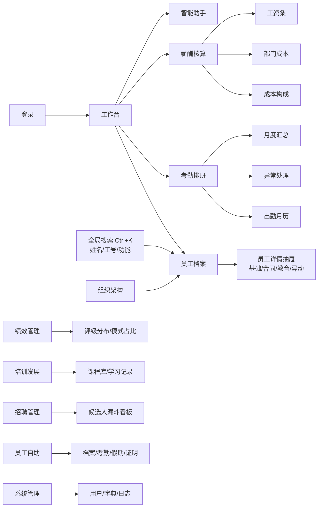

# 01 · 产品功能架构图

> 企业员工管理系统 — 功能架构设计说明书

## 一、产品定位

面向中小型企业的 **一体化人力资源数字化平台**，以「数据驱动决策、人才价值可量化、全员自助协作」为核心理念，覆盖员工全生命周期（选、用、育、留）的 8 大业务模块。

## 二、总体功能架构

```mermaid
graph TD
    A[企业员工管理系统] --> B[应用门户层]
    A --> C[业务功能层]
    A --> D[数据智能层]
    A --> E[基础能力层]

    B --> B1[工作台]
    B --> B2[全局搜索]
    B --> B3[主题与布局定制]
    B --> B4[个人中心/自助]

    C --> C1[组织人事]
    C --> C2[考勤排班]
    C --> C3[薪酬福利]
    C --> C4[绩效目标]
    C --> C5[培训发展]
    C --> C6[招聘人才]
    C --> C7[全员自助]
    C --> C8[系统管理]

    C1 --> C1a[组织架构/岗位体系]
    C1 --> C1b[员工全生命周期档案]
    C1 --> C1c[入转调离全流程]
    C1 --> C1d[人才标签/九宫格]

    C2 --> C2a[班次配置]
    C2 --> C2b[出勤月历]
    C2 --> C2c[异常自动识别]
    C2 --> C2d[请假/加班/外勤]

    C3 --> C3a[薪酬核算规则]
    C3 --> C3b[一键批量核算]
    C3 --> C3c[工资条]
    C3 --> C3d[五险一金/个税]

    C4 --> C4a[OKR/KPI/360考核]
    C4 --> C4b[评级分布]
    C4 --> C4c[绩效面谈]

    C5 --> C5a[课程库]
    C5 --> C5b[学习记录]
    C5 --> C5c[能力雷达]

    C6 --> C6a[岗位需求]
    C6 --> C6b[候选人漏斗]
    C6 --> C6c[渠道效能]

    C7 --> C7a[我的档案/考勤/工资条]
    C7 --> C7b[假期余额/电子证明]

    C8 --> C8a[用户角色RBAC]
    C8 --> C8b[数据字典]
    C8 --> C8c[操作审计日志]

    D --> D1[智能助手·自然语言问数]
    D --> D2[HR运营看板]
    D --> D3[专项分析]
    D1 --> D1a[18类意图引擎]
    D1 --> D1b[结论+图表+表格+追问]
    D1 --> D1c[多轮上下文/角色收敛]
    D1 --> D1d[我的考勤/绩效/工资]
    D2 --> D2a[出勤率/离职率]
    D3 --> D3a[流失预测]
    D3 --> D3b[绩效热力图]
    D3 --> D3c[人力成本桑基图]

    E --> E1[统一认证 JWT]
    E --> E2[RBAC 权限]
    E --> E3[数据字典]
    E --> E4[操作留痕]
    E --> E5[消息待办]
```

## 三、信息架构（页面地图）

## 四、角色与权限矩阵

| 功能模块 | 系统管理员 ADMIN | HR 专员 HR | 部门主管 MANAGER | 普通员工 EMPLOYEE |
|---|---|---|---|---|
| 工作台 | ✅ | ✅ | ✅ | ✅（个人视角） |
| 智能助手 | ✅ | ✅ | ✅ | ✅（个人数据，薪资成本收敛） |
| 组织架构 | ✅ | ✅ | ✅ | — |
| 员工档案 | ✅ 全量（读写） | ✅ 全量（读写） | ✅ 本部门（只读） | — |
| 考勤排班 | ✅ | ✅ | ✅ | —（自助看个人） |
| 薪酬核算 | ✅ | ✅ | — | —（自助看工资条） |
| 绩效管理 | ✅ | ✅ | ✅ | —（自助看个人） |
| 培训发展 | ✅ | ✅ | ✅ | ✅ |
| 招聘管理 | ✅ | ✅ | ✅ | — |
| 员工自助 | ✅ | ✅ | ✅ | ✅ |
| 系统管理 | ✅ | — | — | — |

## 五、演示账号

| 账号 | 密码 | 角色 | 说明 |
|---|---|---|---|
| admin | 123456 | 系统管理员 | 全模块可见 |
| hr | 123456 | HR 专员 | 人事/考勤/薪酬/招聘 |
| manager1 | 123456 | 部门主管 | 组织/档案/绩效（部门视角） |
| employee1 | 123456 | 普通员工 | 工作台/培训/自助 |
