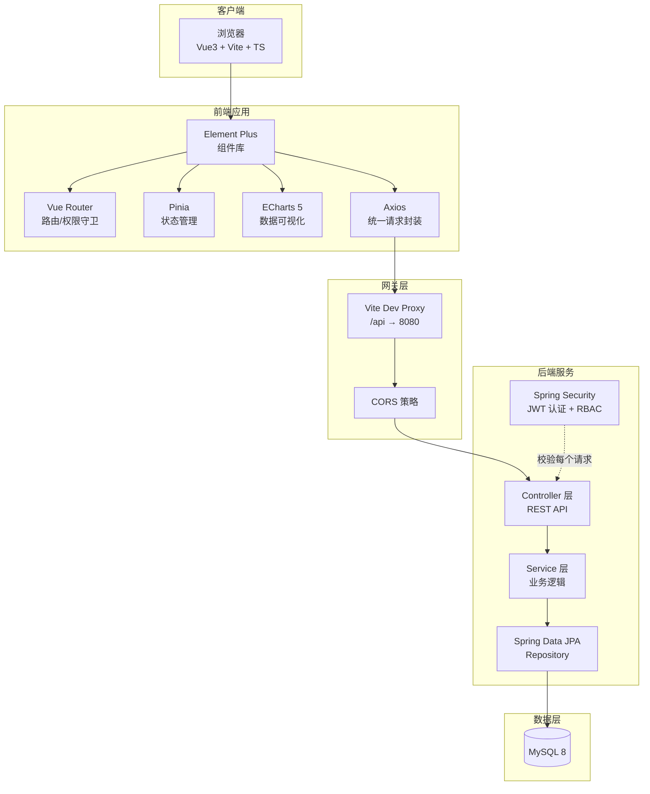
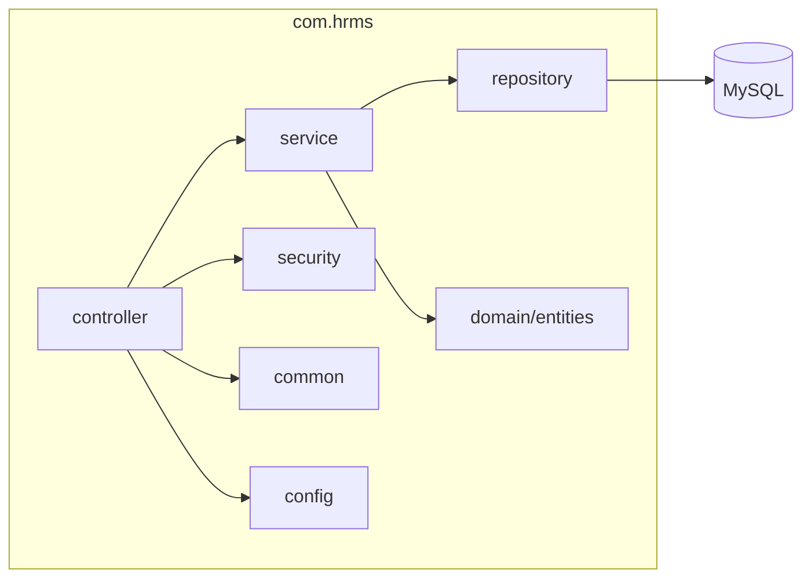
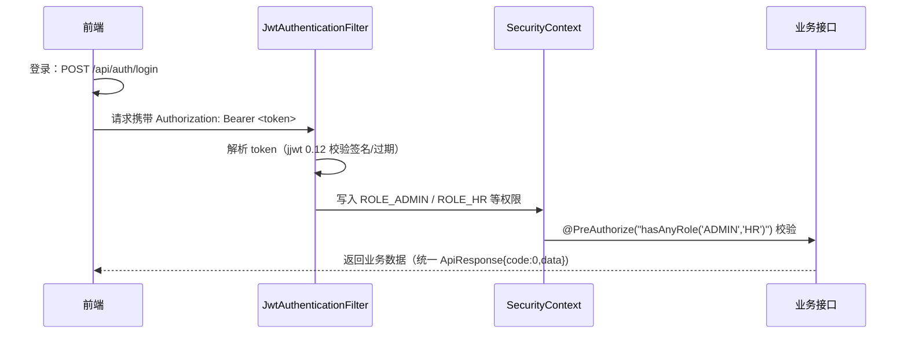
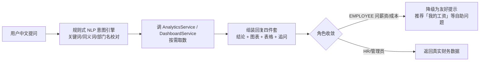

# 02 · 前后端技术架构设计

> 企业员工管理系统 — 技术架构说明书

## 一、总体架构



## 二、技术选型

| 层次 | 技术 | 版本 | 说明 |
|---|---|---|---|
| 前端框架 | Vue 3（组合式 API + `<script setup>`） | ^3.4 | 响应式 + 编译时优化 |
| 构建工具 | Vite | ^5.3 | 秒级热更新，分包优化 |
| 类型 | TypeScript | ^5.4 | 全链路类型安全 |
| UI 组件 | Element Plus | ^2.7 | 企业级中后台组件 |
| 可视化 | Apache ECharts | ^5.5 | KPI / 趋势 / 热力 / 雷达 / 漏斗 |
| 状态 | Pinia | — | 认证与主题状态 |
| 路由 | Vue Router 4 | ^4.4 | 动态权限路由 + 守卫 |
| 请求 | Axios | — | 拦截器 + 统一错误处理 |
| 后端框架 | Spring Boot 3 | 3.3.5 | 生产级 Java 后端 |
| ORM | Spring Data JPA | — | 实体驱动建表，DDL 自动 |
| 安全 | Spring Security + JWT | — | 无状态认证 + 方法级授权 |
| 数据库 | MySQL | 8.x | 本地实例 |

## 三、后端分层与目录结构



```
backend/src/main/java/com/hrms
├── config          # SecurityConfig（401 入口点）/ DataSeeder（演示数据，固定随机种子）
├── security        # JwtUtil / JwtAuthenticationFilter / LoginUser
├── common          # ApiResponse 统一响应 / BizException / GlobalExceptionHandler / SecurityUtil
├── controller      # 15 个模块控制器（REST，含 AssistantController）
├── service         # 业务逻辑（Dashboard/Employee/Attendance/Payroll/Analytics/Assistant/...）
├── repository      # Spring Data JPA Repository（含自定义查询）
├── domain          # 22 个领域实体（8 大模块）
└── dto             # 入参/出参对象（含 AssistantReply 助手回复契约）
```

## 四、认证与授权链路



- **JWT 载荷**：uid / username / role / employeeId / expire（`employeeId` 供员工自助与助手「我的考勤/绩效/工资」从 token 直接定位本人数据）
- **无状态**：服务端不存 Session，天然支持多实例横向扩展
- **未认证兜底**：`SecurityConfig` 自定义 `AuthenticationEntryPoint`，未登录访问输出统一 JSON `{"code":401,"message":"未登录或登录已过期","data":null}`，前端按 HTTP 401 分级提示
- **RBAC 收敛**：敏感控制器（分析/系统/考勤/招聘/薪酬等）类级 `@PreAuthorize("hasAnyRole('ADMIN','HR',...)")`，前端路由 `meta.roles` 过滤菜单 + async 导航守卫（无 token→登录页、角色不匹配→弹回工作台）+ Axios 拦截器三重兜底
- **前端配合**：路由 `meta.roles` 过滤菜单 + 导航守卫 + Axios 401 拦截（对 `/auth/login` 跳过，避免登录失败被整页跳转）

### 智能助手（自然语言问数）

`POST /api/assistant/ask` 一次交互返回 `AssistantReply`：`reply`（自然语言结论）+ `chart`（五种图表类型契约：折线/柱状/饼图/漏斗/雷达）+ `table`（表格）+ `suggestions`（推荐追问）+ `context`（话题上下文）。核心链路：



- 覆盖 18 类意图（规模/部门/薪酬/考勤/招聘/结构/九宫格/人效/培训/绩效/能力雷达/组织架构/个人自助…），零外部 LLM、零 API key，结果确定可测。
- 多轮上下文：内存记录「最近意图 + 最近问题」，追问「那最多的呢」自动续接上一话题；聊天历史按用户维度保存，刷新页面可还原。
- 前端 `renderText()` 对助手文本先做 HTML 实体转义再渲染，杜绝 XSS。

## 五、数据模型（核心实体）

| 模块 | 实体 | 关键字段 |
|---|---|---|
| 系统 | User / DictItem / OperationLog | 角色、字典、审计日志 |
| 组织 | Department / Position | 树形组织、P/M 双序列岗位 |
| 员工 | Employee / Contract / Education / Transfer | 全生命周期字段、人才标签、九宫格定位 |
| 考勤 | Shift / AttendanceRecord / LeaveRequest | 班次、每日打卡记录（带索引）、请假 |
| 薪酬 | PayrollRecord | 应发/扣减/实发，DRAFT→CALCULATED→CONFIRMED→PAID |
| 绩效 | PerformanceRecord | 周期/模式/得分/评级/面谈 |
| 培训 | TrainingCourse / TrainingRecord | 课程库、学习记录 |
| 招聘 | Candidate / JobRequisition | 候选人漏斗、岗位需求 |
| HR | Announcement / Todo / Certificate | 公告、待办、电子证明 |

关联策略：为避免懒加载序列化问题，实体间采用 **扁平外键（Long 字段）+ 少量 EAGER @ManyToOne**，跨实体聚合在 Service 层组装。

## 六、演示数据设计

- 使用 `Random(42)` **固定随机种子**，每次启动 `ddl-auto: create-drop` 重建库表并重灌数据，保证演示环境可复现。
- 规模：22 个部门（集团→中心→部门）、46 个岗位、61 名员工（在职 57 人）、近 7 个月考勤与薪酬（7584 条考勤 / 399 条薪酬）、3 期绩效、12 门课程、8 个招聘岗位与 90 名候选人。
- **灌数顺序**：先 `saveAll` 员工再 `assignManagers` 再二次 `saveAll`，保证部门/经理引用在赋值前已持久化（`managerId` 不为 null）。

## 七、前端工程化

- **设计令牌**：`:root` 与 `html.dark` 双套 CSS 变量，覆盖 Element Plus 主色（商务蓝 `#2f6bf0`），一键明暗切换。
- **组件封装**：`BaseChart`（ECharts 封装，响应式 resize + 主题联动）、`KpiCard`、`ChartCard`、`StatusTag`（状态码→文案/色彩统一映射）。
- **API 层**：`request.ts` 统一 axios 实例 + `http` 类型化方法；`api/index.ts` 按模块导出类型化接口。
- **性能**：Vite `manualChunks` 将 echarts / element-plus 独立分包，首屏按路由懒加载。

## 八、部署与运行

| 项 | 值 |
|---|---|
| 后端端口 | 8080 |
| 前端端口 | 5173（代理 /api → 8080） |
| 数据库 | MySQL localhost:3306 / hrms（账号由环境变量 `DB_USERNAME`/`DB_PASSWORD` 注入） |
| JWT 密钥 | `application.yml` 中 `hrms.jwt.secret`，可用环境变量覆盖 |
| 启动顺序 | ① 启动 MySQL ② 启动后端（自动建表+灌数据）③ `npm run dev` 启动前端 |
