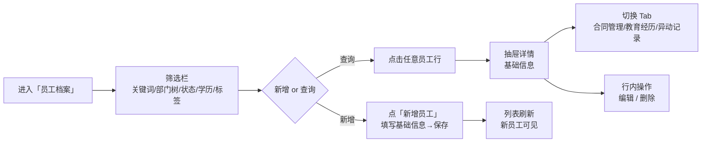
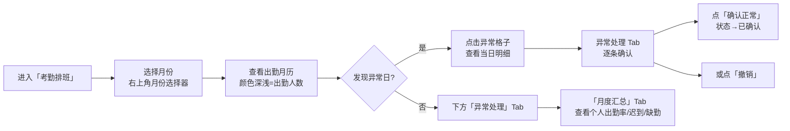
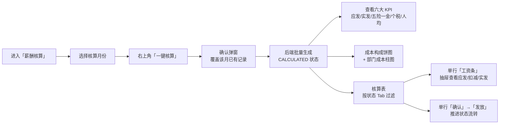
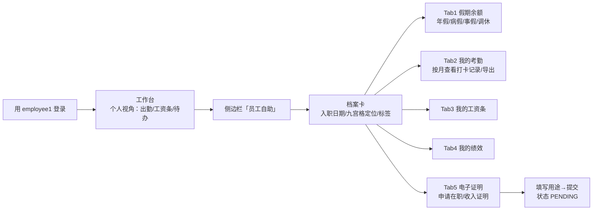

# 03 · 核心功能用户操作路径说明

> 企业员工管理系统 — 五大核心场景操作指引

---

## 场景一 · 高管问数：智能助手

**目标用户**：admin / hr / manager / employee

**操作要点**：
1. 登录页点击演示账号 `admin` 一键登录，或手工输入 admin/123456。
2. 工作台顶栏快捷按钮直达智能助手；侧边栏「智能助手」亦可进入；员工账号同样可用（薪资/成本意图自动降级）。
3. 支持「我的考勤 / 我的绩效 / 我的工资」个人自助问答，token 中 `employeeId` 声明直接定位本人数据。
4. 提问返回**结论 + 图表 + 表格 + 推荐追问**四件套，数据来自后端聚合接口；刷新页面后历史对话与图表自动还原。

---

## 场景二 · HR 管档：员工全生命周期档案

**目标用户**：admin / hr / manager

**操作要点**：
1. 部门使用**树形下拉**，可只看某个中心/部门的下属员工。
2. 点击员工行（头像区）打开**右侧详情抽屉**，四个 Tab 覆盖「基本信息 → 合同 → 教育 → 异动」完整档案。
3. 人才标签按部门/岗位维度筛选，支持「导出当前页 CSV」。
4. 全局搜索框（`Ctrl K`）可直接搜姓名/工号并跳转定位到该员工——详情按 id 直查，**不受列表分页影响**（任意页可定位）。
5. 新增/编辑/删除仅 `ADMIN / HR` 可用，`MANAGER` 仅只读浏览。

---

## 场景三 · HR 考勤：异常识别与确认归档

**目标用户**：admin / hr / manager

**操作要点**：
1. 月历格子中 **`缺N` 红色、`迟N` 橙色**高亮异常，点击查看当日六类出勤计数。
2. 异常处理列表默认按员工分组展示，`确认正常` 即归档，`撤销` 可回退。
3. 月度汇总按「有异常」优先排序，出勤率用进度条可视化（绿/橙/红三档）。

---

## 场景四 · HR 算薪：一键核算与工资条

**目标用户**：admin / hr

**操作要点**：
1. `一键核算` 会**删除该月旧记录并重建**（幂等），适合反复重算演示；**已确认 / 已发放的月份不可重算**（状态机前置校验），避免覆盖已归档数据。
2. 状态流转：`已核算(CALCULATED) → 已确认(CONFIRMED) → 已发放(PAID)`，**必须先确认才能发放**；状态通过独立接口持久化，刷新页面后仍保持。
3. 工资条抽屉内**应发、扣减、实发**三大分区清晰展示五险一金与个税明细。
4. 员工在「员工自助」中也可查看本人工资条。

---

## 场景五 · 员工自助：查询与申请

**目标用户**：employee（employee1 / 123456）

**操作要点**：
1. 员工登录后**工作台自动切换为个人视角**（出勤率/工资条/假期余额），与管理员视角数据隔离。
2. 「我的考勤」支持按月筛选并导出 CSV 打卡记录。
3. 「电子证明」提交后状态为待审批，形成闭环演示。
